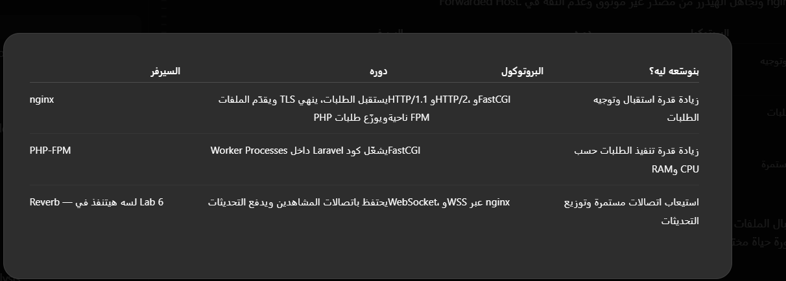
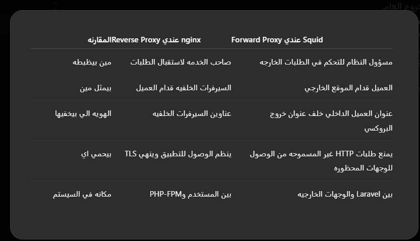

--------------------------------------------------------------------------------------------
/**
    [LAP1 ]
    *//

 بدأت اجرب رحلة الـDNS باستخدام dig +trace على example.com.
شوفت الـRoot Server بيرجعني لسيرفرات .com، وبعدها الـTLD بيوجهني للـAuthoritative
المسئول عن الدومين، وهو الي رجع الـIP النهائي.
بعدها سألت 1.1.1.1 مرتين علشان اشوف تأثير الكاش على الـTTL.
في الاول القيم كانت بتتغير ومش بتقل بشكل منتظم، فمقدرتش اثبت السبب من النتيجه لوحدها.
جربت باستخدام TCP وkeepopen، والـTTL نزل من 241 لـ238 بعد انتظار 3 ثواني،
وده وضح ان الرد من الكاش بيرجع بالوقت المتبقي، مش بيبدأ المده من الاول مع كل طلب.
بعد كدا ضفت Local DNS Lab على نفس المشروع باستخدام نسختين CoreDNS.
واحده Authoritative فيها سجلات brand.test، والتانيه Caching Resolver بتسأل الاولى
وتحتفظ بالاجابه حسب الـTTL. وضفت كونتينر ادوات فيه dig وcurl علشان اجرب من خلاله.
خليت go.brand.test يشاور على nginx بعنوان 172.30.53.10 وTTL مدته 60 ثانيه.
اختبرت الـAuthoritative مباشرة ورجع نفس العنوان ومعاه علامة aa،
وبعدها جربت الـResolver والـTTL قل من 25 لـ22 بعد 3 ثواني.
ربطت nginx بشبكة اللاب مع احتفاظه بشبكة التطبيق علشان يفضل يوصل لـapp1 وapp2.
اختبرت الوصول الاول باستخدام curl --resolve، وبعدها خليت كونتينر الادوات يستخدم
الـResolver بتاعنا وجربت من غير --resolve، والاتنين رجعوا 200 على /up.
كدا اتأكدت ان اسم الدومين بيتحل من خلال DNS اللاب والطلب بيوصل لـnginx وبعده Laravel،
من غير ما اغير اعدادات DNS بتاعت Windows.
لسا مجربتش تغيير الـIP مع قيم TTL المختلفه، ولا الـNegative Cache وخطة الـCutover،
وكمان اختبار /up بيثبت ان التطبيق متاح، مش ان الـRedirect بتاع لينك اتجرب بالدومين.

بعد ما جهزت الـDNS جربت تأثير الـTTL مع 100 عميل محاكى،بعد ما جهزت الـDNS جربت تأثير الـTTL مع 100 عميل محاكى،
كل واحد بيبعت طلب كل ثانيه لنفس الـCaching Resolver.
خزنت الـIP القديم في الكاش وبعدها غيرت سجل go.brand.test عند الـAuthoritative.
مع TTL مدته 60 ثانيه، اول رد بالـIP الجديد ظهر بعد حوالي 60.009 ثانيه،
ومع TTL مدته 5 ثواني ظهر بعد حوالي 5.002 ثانيه.
التجربتين خلصوا من غير اخطاء في طلبات DNS ومن غير جولات متأخره.
في اول دقيقه من القياس، تجربة الـ60 ثانيه موصلتش طلبات للـAuthoritative،
لان الإجابه كانت متخزنه قبل بداية القياس والتجديد حصل بعد انتهاء نافذة الدقيقه.
اما تجربة الـ5 ثواني فوصل فيها 20 طلب للـAuthoritative بدل حوالي 6000 طلب من العملاء،
وده وضح ان تقليل الـTTL بيسرع ظهور التغيير بس بيزود عدد مرات الرجوع للمصدر.
العملاء كلهم بيشاركوا Resolver واحد، فالارقام دي تخص شكل التجربه عندي.
بعدها عدلت nginx وخليته يقبل go.brand.test وlocalhost و127.0.0.1،
واي Host تاني يروح لـDefault Server يرجع 421 قبل ما يوصل لـLaravel.
اختبرت الاعداد بـnginx -t وعملت Reload،
وبعت طلب باسم unknown.brand.test فرجع 421 ومعاه Unknown host.
وبعت طلب للدومين المسموح باستخدام curl --resolve على /up فرجع 200،
فكدا اتأكدت ان رفض الاسم المجهول مكسرش الوصول بالاسم الصحيح

كملت تجربة الـTTL بقيمة 3600 ثانيه بعد ما اكتشفت مشكله في تجهيز التجربه الاولى.
كنت مغير TTL لسجل go بس، وسايب سجلات تانيه مصاحبه في الرد بـ60 ثانيه،
فـCoreDNS كان بيستخدم اقل TTL في الرساله والكاش بيتجدد بعد دقيقه بدل ساعه.
عدلت السكريبت وضفت فحص للـTTL الفعلي قبل تشغيل الحمل علشان التجربه تقف لو القيمه غلط.
بعد التصحيح بدأت التجربه بـTTL فعلي 3600، واول رد بالـIP الجديد ظهر بعد 3601.009 ثانيه.
الفرق حوالي ثانيه متوافق مع ان العملاء بيسألوا مره كل ثانيه.
التجربه اشتغلت بـ100 عميل محاكى بيشاركوا نفس الـResolver،
وخلصت من غير اخطاء DNS او جولات متأخره، وبعدها السجل الاصلي رجع تلقائي.
بمقارنة النتايج، التغيير ظهر بعد 5.002 ثانيه مع TTL قيمته 5،
وبعد 60.009 ثانيه مع TTL قيمته 60، وبعد حوالي ساعه مع TTL قيمته 3600.
ده وضح عملي ان تقليل الـTTL بيسرع ظهور تغيير الـIP، مقابل زيادة الرجوع للـAuthoritative.
وقياس طلبات المصدر كان خلال اول دقيقه بعد تجهيز الكاش، مش متوسط الحمل طوال كل تجربه

جربت اسأل عن اسم جديد قبل ما اضيفه، والـResolver رجع NXDOMAIN وخزن الاجابه السلبيه.
بعدها ضفت السجل واتأكدت ان الـAuthoritative بيرجع الـIP،
لكن الـResolver فضل يقول ان الاسم مش موجود لحد انتهاء الكاش.
الـIP ظهر من خلاله بعد حوالي 60.069 ثانيه من اول اجابه سلبيه.
المده الفعليه كانت حوالي دقيقه حسب SOA TTL الموجود في الرد، مش الـ30 ثانيه الي توقعتها من حقل MINIMUM لوحده.
وده وضح ليه تجربة الدومين قبل تجهيزه ممكن تخلي العميل يفضل شايفه مش موجود حتى بعد اضافة السجل.

جربت تأثير وجود اكتر من طبقة DNS Cache باستخدام كاش عميل محاكى بـPython
ومعاه Caching Resolver حقيقي بـCoreDNS.
خزنت الـIP القديم في الاتنين وبعدها غيرت السجل عند الـAuthoritative.
لما فضيت كاش العميل بس، رجع خد الـIP القديم تاني من الـResolver.
ولما فضيت كاش الـResolver بإعادة تشغيله، السؤال المباشر رجع الـIP الجديد،
لكن العميل فضل يرجع القديم من الكاش بتاعه.
بعد تفريغ كاش العميل كمان، ظهر الـIP الجديد في الرحله كلها.
كدا اتأكدت ان تفريغ طبقه واحده مش شرط يحل المشكله لو فيه طبقه تانيه لسا شايله اجابه قديمه.
كاش العميل في التجربه كان محاكاه، ومجربتش تفريغ كاش Windows او المتصفح فعليًا.

الطلب ممكن يعدي على كاش داخل التطبيق او المتصفح، وبعده كاش نظام التشغيل،
وبعده الـCaching Resolver، وممكن الراوتر يبقى وسيط DNS كمان حسب اعدادات الشبكه.
الـAuthoritative هو مصدر السجلات، ومش لازم كل طلب يوصل له طالما فيه اجابه صالحه في الكاش.
على Windows اقدر اعرض كاش النظام باستخدام ipconfig /displaydns،
وافرغه باستخدام ipconfig /flushdns، لكن ده مش بيفرغ كاش المتصفح او الـResolver الخارجي.
في اللاب فضيت كاش CoreDNS بإعادة تشغيل dns-resolver، اما كاش العميل فكان محاكاه.
واستخدام dig مع عنوان سيرفر محدد بيختبر السيرفر ده مباشرة، مش بيثبت حالة كاش Windows.

هنفترض ان النقل يوم الاثنين الساعه 09:00 والـTTL القديم 3600 ثانيه.
هخفضه لـ60 ثانيه من اليوم الي قبله، واستنى على الاقل مدة الـTTL القديم،
لان خفض القيمه عند المصدر مش بيغير اجابه متخزنه بالفعل.
قبل النقل هختبر السيرفر الجديد باستخدام curl --resolve واتأكد ان نفس اكواد الروابط وبياناتها موجوده.
الساعه 09:00 هغير سجل go.brand.test للـIP الجديد، واسيب القديم شغال خلال الانتقال،
واراقب ردود DNS والـRedirect والاخطاء.
لو حصلت مشكله هرجع السجل للـIP القديم، مع العلم ان الرجوع نفسه بيتأثر بالكاش.
بعد استقرار الخدمه هرفع الـTTL تاني.
الـ60 ثانيه بتسيب هامش لهدف الدقيقتين، لكن مقدرش اضمنه لعميل او Resolver بيتجاهل TTL.
ولو العميل طلب brand.test نفسه بدل go.brand.test،
مينفعش احط Plain CNAME على الـApex لانه لازم يحتوي سجلات SOA وNS،
والـCNAME مينفعش يتجمع مع سجلات البيانات دي على نفس الاسم.
هستخدم A وAAAA لو العناوين ثابته، او ALIAS وANAME او CNAME Flattening حسب دعم مزود DNS.
اختبرت لينك فعلي باستخدام go.brand.test عن طريق curl --resolve،
والطلب رجع 302 ومعاه Location للرابط الاصلي https://example.com/article.
كدا اتأكدت ان الدومين المسموح بيوصل لوظيفة الـRedirect نفسها، مش بس صفحة فحص التطبيق.
الاختبار ده تجاوز DNS عمدًا، واختبار حل الاسم من خلال الـResolver كان اتعمل بشكل منفصل.

--------------------------------------------------------------------------------------------
/**
[LAP2 ]
*//

في Lab 2 بدأت بتشغيل HTTPS على nginx باستخدام شهادة محليه ولدتها بـmkcert،
وثبت الـCA على Windows وخليت الشهاده والمفتاح داخل work علشان ميرفعوش على Git.
اختبرت اللينك على بورت 8443 ورجع 302 للرابط الاصلي.
ظهر خطأ في فحص حالة إلغاء الشهاده عند Schannel،
فاستخدمت ssl-revoke-best-effort مع استمرار التحقق من الثقه واسم الدومين، من غير استخدام insecure.
بعدها قارنت اتصال جديد باتصال Keep-alive، واتأكدت ان الطلب التاني استخدم نفس الاتصال.
جهزت كونتينر قياس منفصل واستخدمت tc netem لإضافة تأخير،
وقست RTT فعلي حوالي 1.72 و50.26 و150.27 ms.
لكل حاله شغلت 5 ازواج طلبات وحسبت القيم الوسيطه، من غير متابعة الـRedirect.
في الاتصال الجديد الوقت الكلي كان حوالي 12.56 و221.68 و612.88 ms بالترتيب،
ومع Keep-alive كان حوالي 6.03 و56.16 و157.97 ms.
عند RTT حوالي 50 ms، تجهيز DNS وTCP وTLS استهلك تقريبًا 161 ms،
وعند 150 ms استهلك حوالي 456 ms قبل إرسال طلب HTTP.
ده وضح ان ميزانية 100–200 ms ممكن تخلص بسبب الشبكه قبل تنفيذ كود التطبيق،
وان Keep-alive بيوفر تجهيز الاتصال لكنه مش بيلغي زمن رحلة الطلب والرد.
وقت انتظار اول بايت شامل الشبكه وانتظار التطبيق وتنفيذه، مش قياس وقت الكود وحده.
القياسات الخام اتحفظت تحت work، والسكريبت شال التأخير بعد الانتهاء.

قارنت HTTP/1.1 وHTTP/2 على Redirect واحد وصفحه فيها 50 ملف CSS صغير،
باستخدام 5 عينات لكل حاله، واتأكدت ان البروتوكول المطلوب اتستخدم فعليًا.
محليًا الـRedirect خد حوالي 8.63 ms مع HTTP/1.1 و8.74 ms مع HTTP/2.
الصفحه وملفاتها خدوا 42.71 ms و55.56 ms، فـHTTP/2 مكانش اسرع في الحاله دي.
لما RTT بقى حوالي 50 ms، الـRedirect خد 220.24 ms و214.31 ms،
لكن الصفحه وملفاتها خدوا 840.33 ms مع HTTP/1.1 مقابل 364.48 ms مع HTTP/2.
HTTP/1.1 استخدم 6 اتصالات للصفحه، وHTTP/2 استخدم اتصال واحد مع Streams متوازيه،
فقلل الوقت حوالي 57% مع تأخير الشبكه.
الـMultiplexing فاد الطلبات المتعدده، لكن مش بيشيل تكلفة الشبكه او بيقدم نفس المكسب لطلب Redirect واحد.
القياس لتنزيل الصفحه وملفاتها، مش وقت رسمها في المتصفح، والقيم المعروضه هي Median العينات.

--------------------------------------------------------------------------------------------
/**
[LAP3 ] ->A
*//

في Lab 3A بدأت بفحص الـIP والـHTTPS الي Laravel شايفهم.
الاعداد الاصلي عندي بيستخدم FastCGI وكان بيعدي الاختبار، فعملت وضع مكسور متعمد علشان اثبت المشكله المطلوبه.
في الوضع ده عميلين من كونتينرين مختلفين ظهروا بنفس IP بتاع nginx،
والـvisitor_hash كان واحد، والتطبيق شاف الطلب HTTP رغم ان الاتصال الخارجي HTTPS.
جربت Rate Limit تجريبي بالـIP يسمح بـ3 طلبات في الدقيقه،
اول عميل استهلك التلاته، والعميل التاني رجعله 429 رغم انه لسا مبعتش طلبات.
الحد ده للتجربه، اما Rate Limit إنشاء الروابط عندي مربوط بالـUser ID.
صلحت nginx بحيث يستبدل X-Forwarded-For وX-Forwarded-Proto بقيم الاتصال الفعليه،
ويمرر Host، وخليت Laravel يثق في عنوان nginx المحدد 172.30.53.10 بس.
بعد التصليح العميلين ظهروا بعنوانين مختلفين، وكل واحد ليه Hash وعدّاد مستقل،
والتطبيق عرف ان الاتصال HTTPS.
بعت هيدرز مزوره للـIP والبروتوكول والـHost، لكنها مغيرتش هوية العميل،
والعميل الي استهلك حده فضل بياخد 429 رغم محاولة تغيير الـIP في الهيدر.
شغلت كمان 3 Feature Tests، وكلهم عدوا بـ8 assertions،
لتأكيد الثقه في nginx وتجاهل الهيدرز من مصدر غير موثوق وعدم الثقه في Forwarded Host.

فصلتهم لان استقبال الملفات والطلبات، وتنفيذ PHP، والاحتفاظ باتصالات لايف
ليهم احتياجات ودورة حياة مختلفه، فمقدرش اعتبر زيادة PHP Workers بديل لتوسيع WebSocket Server.

--------------------------------------------------------------------------------------------
/**
[LAP3 ] ->B
*//

في Lab 3B جربت Micro-cache للـRedirect داخل nginx لمدة 3 ثواني،
واستخدمت fastcgi_cache لان nginx عندي بيكلم PHP-FPM عن طريق FastCGI.
التجربه كانت على لينكات منفصله تبدأ بـlab3mc_، مش على كل روابط المشروع.
ردود الـRedirect عندي فيها no-store، فتجاهلت الهيدر ده داخل إعداد التجربه علشان اقدر اقيس تأثير الكاش.
بعت 30 طلب Redirect، منهم 28 اتخدموا من كاش nginx وطلبين بس وصلوا لـLaravel.
بعد تفريغ باتشات الضغطات اتأكدت ان المسجل في الداتابيز ضغطتين بس،
يعني 28 ضغطة متسجلوش لان الطلبات موصلتش للتطبيق اصلا.
جربت كمان اوقف لينك بعد تخزين رده في الكاش،
ورصدت 56 رد 302 HIT بعد تأكيد انتهاء خدمة الإيقاف.
آخر Redirect قديم ظهر بعد 2.877 ثانيه، واول 404 ظهر بعد 2.934 ثانيه.
بعدها قارنت نفس منطق حمل Task 2، كل 100 Redirect مقابل Create واحد،
و80% من القراءات على 10 لينكات ساخنه من اصل 1000 لينك.
شغلت 200 طلب في الثانيه لمدة 30 ثانيه لكل حاله، ومن غير اخطاء او Dropped Iterations.
من غير Micro-cache وصل لـLaravel حوالي 197.98 Redirect في الثانيه وp99 كان 190.89 ms.
مع الكاش وصل حوالي 37.85 Redirect في الثانيه، والـHit Ratio كان 80.88% وp99 بقى 86.75 ms.
الكاش حسن الاداء في التجربه، لكن قررت مش افعله للـRedirect،
لان تسجيل كل ضغطة وتطبيق إيقاف اللينك اهم عندي من مكسب السرعه ده.
رجعت التشغيل من غير Micro-cache، واحتفظت بإعداد التجربه والنتايج للمقارنه.
كاش بيانات اللينك في Redis فضل شغال، لانه بيسرع جلب البيانات من غير ما يمنع الطلب يدخل Laravel.

--------------------------------------------------------------------------------------------
/**
[LAP3 ] ->C
*//

شغلت Squid كـForward Proxy علشان اتحكم في طلبات HTTP وHTTPS الخارجه من Laravel.
ظبطته يسمح بالوجهات العامه على بورتات 80 و443، ويرفض Loopback وPrivate وLink-local ranges،
ومن ضمنها شبكة Docker وعنوان metadata بتاع 169.254.169.254.
فحص عنوان الوجهه بيحصل بعد حل اسمها، مش بمجرد مقارنة اسم الدومين.
جربت https://example.com ورجع 200،
وجربت db-primary على بورت 3306 و127.0.0.1 و169.254.169.254،
وكمان private-destination.test الي بيتحل لعنوان Docker داخلي.
الاربع وجهات رجعوا 403، وظهروا في لوج Squid كـTCP_DENIED،
اما اتصال HTTPS العام فظهر كـCONNECT ناجح.
بعدها خليت Laravel HTTP Client يستخدم البروكسي افتراضيًا من خلال Http::globalOptions،
علشان مش كل استدعاء يحتاج يحدد البروكسي يدوي.
حطيت مهلة اتصال 3 ثواني ومهلة طلب 5 ثواني،
وحددت متابعة الـRedirects بثلاث تحويلات وبروتوكولات HTTP وHTTPS بس.
Validation للرابط لوحده مش كفايه، لان اسم عادي ممكن يتحل لعنوان داخلي،
او رابط عام يحول لوجهه داخليه، فالبروكسي لازم يطبق قواعده على الوجهه المطلوبه في كل طلب.
بعد كدا خليت شبكة التطبيق internal،
والـapp1 وapp2 والـWorker والـScheduler متصلين بالشبكه الداخليه بس،
بينما Squid متصل بالشبكه الداخليه ومعاه شبكة خروج للانترنت.
اعدت إنشاء الشبكه من غير حذف الـVolumes علشان الداتا تفضل موجوده.
اختبرت app1 وapp2 باستخدام Http::get من غير تحديد proxy داخل الطلب،
والرابط العام اشتغل والوجهات الداخليه اترفضت في الاتنين.
جربت اتجاوز البروكسي باتصال TCP مباشر لـ1.1.1.1 على بورت 443،
وفشل من التطبيقين برسالة Network is unreachable.
نفس الوجهه كانت متاحه من كونتينر الادوات غير المعزول،
فكدا اتأكدت ان الفشل بسبب عزل شبكة التطبيق، مش لان الوجهه نفسها واقعه.
جربت كمان cURL مع تعطيل البروكسي وفشل في حل اسم الموقع،
لكن اختبار TCP بالـIP كان الدليل المباشر على منع الخروج العام.
العزل ده بيمنع الخروج المباشر للانترنت، مش اتصالات الخدمات الداخليه الي التطبيق محتاجها.
سياسة البروكسي الافتراضيه تخص Laravel HTTP Client،
واتصالات MariaDB وRedis وMinIO الداخليه ليها اعداداتها المنفصله.
حفظت نتايج الاختبارات وفحص الشبكات ولوج Squid تحت work.

